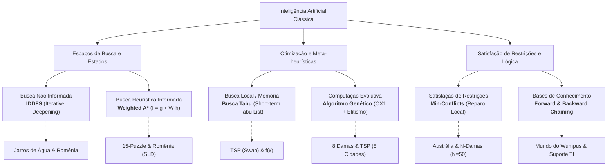

<div align="center">

# Métodos Clássicos de Inteligência Artificial
### Algoritmos de Busca, Otimização Combinatória, CSPs e Inferência Simbólica

[](https://www.python.org/)
[](LICENSE)
[](https://fga.unb.br/)
[]()

**Pedro Gomes Oliveira** — Matrícula: `211031440`  
Engenharia de Software — Faculdade de Ciências e Tecnologias em Engenharia (FGA / FCTE)  
**Universidade de Brasília (UnB)**  
*Disciplina: FGA0221 – Inteligência Artificial*  
*Docente: Prof. Dr. Fabiano Araujo Soares*

</div>

---

## 📌 Visão Geral

Este repositório reúne implementações experimentais completas, modulares e documentadas dos principais **métodos clássicos de Inteligência Artificial**, englobando desde técnicas de busca heurística em espaços de estados e otimização meta-heurística até problemas de satisfação de restrições (CSP) e dedução simbólica em agentes lógicos.

Cada projeto apresenta duas vertentes empíricas:
1. **Problema Canônico/Aula:** Formulações clássicas consagradas na literatura (Russell & Norvig), como o *Mapa da Romênia*, *8 Damas*, *Coloração de Mapas* e o *Mundo do Wumpus*.
2. **Problema Alternativo/Aplicado:** Extensões de maior complexidade combinatória ou aplicações práticas, como o *15-Puzzle*, o *Problema do Caixeiro Viajante (TSP)*, o *Problema dos Jarros de Água* e *Sistemas Especialistas de Diagnóstico de Redes*.

Todos os algoritmos foram projetados **sem dependências externas**, utilizando puramente a biblioteca padrão do Python, priorizando legibilidade, corretude e rigor conceitual.

---

## 🧠 Taxonomia dos Métodos Implementados



---

## 🔬 Matriz de Projetos e Algoritmos

| # | Módulo / Paradigma | Algoritmo Central | Problema Clássico | Problema Alternativo / Extensão | Script |
|:---:|:---|:---|:---|:---|:---:|
| **01** | **Busca Não Informada** | Busca em Profundidade Iterativa (**IDDFS**) | Rota no Mapa da Romênia (*Arad $\rightarrow$ Bucareste*) | Problema dos Jarros de Água (capacidades 5L e 3L $\rightarrow$ meta 4L) | [`01_busca_nao_informada.py`](Entrega_02/01_busca_nao_informada.py) |
| **02** | **Busca Informada** | Busca A* Ponderada (**Weighted A***) | Rota na Romênia (*Heurística de Linha Reta - SLD*) | Quebra-Cabeça de 15 Peças (*15-Puzzle* com Distância de Manhattan) | [`02_busca_informada.py`](Entrega_02/02_busca_informada.py) |
| **03** | **Busca Complexa / Local** | **Busca Tabu** (*Tabu Search* com lista FIFO) | Maximização da Função Côncava $f(x) = -x^2 + 4x + 1$ | Caixeiro Viajante (*TSP* - 5 cidades, vizinhança por *Swap 2-opt*) | [`03_busca_complexa.py`](Entrega_02/03_busca_complexa.py) |
| **04** | **Algoritmos Genéticos** | **AG** com *Order Crossover (OX1)* e Elitismo | Problema das 8 Damas (Cromossomo Permutacional) | Caixeiro Viajante (*TSP* - 8 cidades, representação de ordem) | [`04_algoritimo_genetico.py`](Entrega_02/04_algoritimo_genetico.py) |
| **05** | **Satisfação de Restrições (CSP)** | Heurística **Min-Conflicts** (*Reparo Local*) | Coloração do Mapa dos Estados da Austrália (3 cores) | Problema das N-Damas escalável ($N = 8 \dots 50$) | [`05_CSP.py`](Entrega_02/05_CSP.py) |
| **06** | **Bases de Conhecimento** | **Forward** e **Backward Chaining** (Cláusulas de Horn) | Agente Lógico no Mundo do Wumpus (Dedução de Percepções) | Sistema Especialista para Diagnóstico de Falhas em Redes / TI | [`06_banco_de_conhecimento.py`](Entrega_02/06_banco_de_conhecimento.py) |

---

## 📂 Estrutura do Repositório

```bash
IA/
├── Entrega_01/
│   └── relatorio_metodos_classicos_ia_PedroGomes_211031440.docx  # Documentação inicial
├── Entrega_02/
│   ├── 01_busca_nao_informada.py       # IDDFS (Jarros e Romênia)
│   ├── 02_busca_informada.py           # Weighted A* (15-Puzzle e Romênia)
│   ├── 03_busca_complexa.py            # Busca Tabu (TSP e Maximização)
│   ├── 04_algoritimo_genetico.py       # AG com OX1 e Elitismo (8 Damas e TSP)
│   ├── 05_CSP.py                       # Min-Conflicts (Austrália e N-Damas)
│   ├── 06_banco_de_conhecimento.py     # Inferência Simbólica (Wumpus e TI)
│   ├── Algoritimos_entrega2.docx        # Memória de cálculo e notas
│   └── relatorio_metodos_classicos_ia_PedroGomes_211031440.pdf   # Relatório Técnico Final
├── .gitignore                          # Regras de exclusão Git (ignora cache, temp docs)
├── LICENSE                             # Licença de código aberto MIT
├── main.py                             # Executor interativo centralizado via CLI
├── README.md                           # Documentação técnica e guia do portfólio
└── requirements.txt                    # Declaração de ambiente e requisitos
```

---

## 🚀 Como Executar

### Pré-requisitos
- **Python 3.8 ou superior** instalado no ambiente (nenhuma biblioteca externa via `pip` é necessária).

### 1. Clonar o Repositório
```bash
git clone https://github.com/<seu-usuario>/IA-Metodos-Classicos.git
cd IA-Metodos-Classicos
```

### 2. Executar via Menu Interativo (`main.py`)
Para executar qualquer módulo ou rodar todos os testes de uma só vez:

```bash
# Iniciar o menu interativo:
python main.py

# Ou executar todos os módulos diretamente:
python main.py --all

# Ou executar um módulo específico diretamente por número (ex: Weighted A*):
python main.py 2
```

### 3. Executar Módulos Individualmente
Caso prefira rodar os scripts de forma isolada:

```bash
python Entrega_02/01_busca_nao_informada.py
python Entrega_02/02_busca_informada.py
python Entrega_02/03_busca_complexa.py
python Entrega_02/04_algoritimo_genetico.py
python Entrega_02/05_CSP.py
python Entrega_02/06_banco_de_conhecimento.py
```

---

## 📊 Destaques Metodológicos e Resultados

### 1. Busca Não Informada — IDDFS
- **Equilíbrio Ótimo:** Combina a economia de memória da Busca em Profundidade ($O(b \cdot d)$) com a garantia de otimalidade e completude da Busca em Largura ($O(b^d)$).
- **Problema dos Jarros (5L e 3L):** O algoritmo encontra a sequência mínima de 6 passos para isolar exatamente 4 litros no jarro de maior capacidade.

### 2. Busca Informada — Weighted A*
- **Equação:** $f(n) = g(n) + W \cdot h(n)$.
- **Análise Experimental:**
  - $W = 1.0$ (A* Clássico): Garante a rota de menor custo real ($418\text{ km}$, 6 nós expandidos).
  - $W = 2.0$ (Sub-ótimo acelerado): Expande menos nós (4 nós expandidos), convergindo mais rápido com leve relaxamento no custo da rota ($450\text{ km}$).
- **15-Puzzle:** A heurística de Manhattan associada a $W > 1$ permite mitigar o fator de ramificação exponencial e solucionar tabuleiros de alta complexidade.

### 3. Busca Local — Tabu Search
- **Superação de Ótimos Locais:** Uso de memória de curto prazo (lista FIFO de tabus) impede que o algoritmo retorne a estados recentemente visitados.
- **TSP com Permutação:** Implementação de vizinhança baseada em *Swap 2-opt*, minimizando a distância do circuito fechado de cidades.

### 4. Algoritmos Genéticos — Order Crossover (OX1)
- **Representação Permutacional:** Em problemas como as 8 Damas e o Caixeiro Viajante, cruzamentos tradicionais de 1 ponto geram soluções inválidas (duplicações e omissões). O operador **OX1** garante preservação estrita de genes válidos sem necessidade de reparo.
- **Elitismo:** Garante que os melhores indivíduos sobrevivam intactos entre as gerações, acelerando a convergência para o fitness máximo de 28 conflitos zero nas 8 Damas.

### 5. CSP — Min-Conflicts
- **Escalabilidade Extrema:** Em contraste com o *Backtracking* puro com poda, o Min-Conflicts atua como um reparo local guloso, sendo capaz de resolver o problema das Damas para $N=50$ ou superiores em frações de segundo.

### 6. Agentes Baseados em Conhecimento
- **Forward Chaining (Data-Driven):** Utilizado pelo agente no *Mundo do Wumpus* para derivar novos fatos seguros a partir de percepções sensoriais imediatas (*brisa* e *fedor*).
- **Backward Chaining (Goal-Driven):** Aplicado a árvores de regras para diagnóstico reverso de conectividade em sistemas de TI.

---

## 📄 Relatório Técnico Completo

Para uma análise formal completa contendo deduções matemáticas, tabelas de complexidade de tempo/espaço, métricas comparativas e fundamentação bibliográfica, consulte o documento oficial:

* 📑 **[Relatório Técnico Consolidado (PDF)](Entrega_02/relatorio_metodos_classicos_ia_PedroGomes_211031440.pdf)**

---

## 👨‍💻 Autor

| Foto / Perfil | Dados de Identificação |
|:---:|:---|
| <br /><sub><b>Pedro Gomes Oliveira</b></sub> | **Instituição:** Universidade de Brasília (UnB)<br/>**Campus:** Faculdade do Gama (FGA)<br/>**Curso:** Engenharia de Software<br/>**Matrícula:** 211031440<br/>**GitHub:** [@pedrogomesoliveira](https://github.com/pedrogomesoliveira)<br/>**Email:** 211031440@aluno.unb.br |

---

## 📜 Licença

Este projeto é distribuído sob os termos da licença **MIT**. Consulte o arquivo [LICENSE](LICENSE) para mais detalhes.
