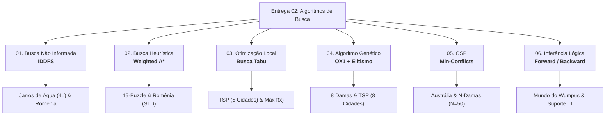

<div align="center">

# FGA0221 – Inteligência Artificial
### Portfólio de Atividades Práticas e Teóricas | UnB – FGA

[](https://www.python.org/)
[](LICENSE)
[](https://fga.unb.br/)
[]()

**Pedro Gomes Oliveira** — Matrícula: `211031440`  
Engenharia de Software — Faculdade de Ciências e Tecnologias em Engenharia (FGA / FCTE)  
**Universidade de Brasília (UnB)**  
*Docente Responsável: Prof. Dr. Fabiano Araujo Soares*

</div>

---

## 📌 Visão Geral do Repositório

Este repositório consolida as entregas acadêmicas e laboratoriais da disciplina de **Inteligência Artificial (FGA0221)** do curso de Engenharia de Software da Universidade de Brasília:

* **[Entrega 01 — Métodos Clássicos de IA](#-entrega-01--métodos-clássicos-de-ia-relatório-técnico):** Relatório técnico e analítico consolidado, cobrindo a fundamentação teórica, análise de complexidade de tempo/espaço, propriedades de completude/otimalidade e avaliação comparativa das abordagens clássicas da literatura (Russell & Norvig).
* **[Entrega 02 — Algoritmos de Busca](#-entrega-02--algoritmos-de-busca-implementações-em-código):** Implementação prática e modular de 6 famílias de algoritmos de busca, otimização combinatória, CSP e raciocínio lógico em Python puro, com suíte de testes e validação empírica.

---

## 📑 Entrega 01 — Métodos Clássicos de IA (Relatório Técnico)

A **Entrega 1** compreende o estudo formal, dedutivo e comparativo dos métodos clássicos que fundamentam a Inteligência Artificial simbólica e heurística. O documento aborda a formulação matemática de espaços de estados, funções heurísticas admissíveis e consistentes, operadores genéticos para representações restritas e mecanismos de inferência lógica guiados por dados e por metas.

### 📂 Artefatos da Entrega 01
* 📄 **[Relatório Técnico Consolidado (PDF)](Entrega_01/relatorio_metodos_classicos_ia_PedroGomes_211031440.pdf)** — Versão oficial diagramada para leitura e avaliação.
* 📝 **[Documento Editável (DOCX)](Entrega_01/relatorio_metodos_classicos_ia_PedroGomes_211031440.docx)** — Versão fonte formatada conforme normas acadêmicas.

### 🔍 Tópicos e Paradigmas Analisados
1. **Busca Cega vs. Busca Informada:** Análise de fator de ramificação, fronteiras de exploração e o impacto de heurísticas no custo de busca.
2. **Otimização Local e Paisagens de Estados:** Limitações de *Hill-Climbing* e a eficácia de listas de memória de curto prazo (Busca Tabu).
3. **Computação Evolutiva em Espaços Permutacionais:** Preservação de integridade estrutural via operadores de recombinação especializados (*Order Crossover*).
4. **Resolução de CSPs por Reparo Local:** Contraste de desempenho entre *Backtracking* com Poda e heurísticas gulosas de conflito mínimo (*Min-Conflicts*).
5. **Representação de Conhecimento e Agentes Lógicos:** Prova de teoremas sobre Cláusulas de Horn e dedução sensorial no ambiente do *Wumpus*.

---

## 💻 Entrega 02 — Algoritmos de Busca (Implementações em Código)

A **Entrega 2** consiste nas implementações computacionais dos algoritmos de busca e resolução de problemas. Cada módulo resolve dois cenários:
1. **Problema da Aula:** Desafio clássico da bibliografia da disciplina.
2. **Problema Alternativo:** Problema complementar de alta complexidade ou aplicação em engenharia.

Todos os códigos utilizam estritamente a **biblioteca padrão do Python** (zero dependências externas como NumPy ou SciPy), focando em clareza algorítmica e facilidade de execução.



### 🔬 Matriz de Algoritmos e Implementações

| Script | Algoritmo | Problema da Aula | Problema Alternativo | Destaque Técnico |
|:---|:---|:---|:---|:---|
| [`01_busca_nao_informada.py`](Entrega_02/01_busca_nao_informada.py) | **IDDFS** (*Iterative Deepening*) | Rota no Mapa da Romênia (*Arad $\rightarrow$ Bucareste*) | Problema dos Jarros de Água (5L e 3L $\rightarrow$ 4L) | Memória $O(b \cdot d)$ com garantia de otimalidade por passos |
| [`02_busca_informada.py`](Entrega_02/02_busca_informada.py) | **Weighted A*** ($w \ge 1.0$) | Rota na Romênia (*SLD Heuristic*) | 15-Puzzle (*Distância de Manhattan*) | Trade-off controlado: menor expansão de nós para $w > 1$ |
| [`03_busca_complexa.py`](Entrega_02/03_busca_complexa.py) | **Busca Tabu** | Maximização da Função Côncava $f(x) = -x^2 + 4x + 1$ | Caixeiro Viajante (*TSP* - Vizinhança *Swap*) | Lista FIFO de tabus para escape sistemático de ótimos locais |
| [`04_algoritimo_genetico.py`](Entrega_02/04_algoritimo_genetico.py) | **AG** (*OX1 + Elitismo*) | Problema das 8 Damas (Aptidão Máx: 28) | Caixeiro Viajante (*TSP* - 8 Cidades) | Recombinação *Order Crossover* para evitar quebra de permutações |
| [`05_CSP.py`](Entrega_02/05_CSP.py) | **Min-Conflicts** | Coloração do Mapa dos Estados da Austrália | Problema das N-Damas escalável ($N=8 \dots 50$) | Reparo local guloso resolvendo tabuleiros $50\times 50$ em milissegundos |
| [`06_banco_de_conhecimento.py`](Entrega_02/06_banco_de_conhecimento.py) | **Forward & Backward Chaining** | Dedução Lógica no Mundo do Wumpus | Sistema Especialista para Diagnóstico de Redes/TI | Inferência orientada a dados (*forward*) e guiada a metas (*backward*) |

*Artefato auxiliar da Entrega 2:* [`Entrega_02/Algoritimos_entrega2.docx`](Entrega_02/Algoritimos_entrega2.docx) (memória descritiva dos códigos).

---

## 📂 Estrutura Completa de Diretórios

```bash
IA/
├── Entrega_01/                                                      # ENTREGA 1: MÉTODOS CLÁSSICOS DE IA
│   ├── relatorio_metodos_classicos_ia_PedroGomes_211031440.pdf     # Relatório consolidado (PDF oficial)
│   └── relatorio_metodos_classicos_ia_PedroGomes_211031440.docx    # Documento acadêmico editável
│
├── Entrega_02/                                                      # ENTREGA 2: ALGORITMOS DE BUSCA
│   ├── 01_busca_nao_informada.py                                   # IDDFS (Jarros e Romênia)
│   ├── 02_busca_informada.py                                       # Weighted A* (15-Puzzle e Romênia)
│   ├── 03_busca_complexa.py                                        # Busca Tabu (TSP e f(x))
│   ├── 04_algoritimo_genetico.py                                   # Algoritmo Genético (8 Damas e TSP)
│   ├── 05_CSP.py                                                   # Min-Conflicts (Austrália e N-Damas)
│   ├── 06_banco_de_conhecimento.py                                 # Bases de Conhecimento (Wumpus e TI)
│   └── Algoritimos_entrega2.docx                                   # Compilação e documentação dos algoritmos
│
├── .gitignore                                                      # Regras de exclusão do repositório
├── LICENSE                                                         # Licença MIT
├── main.py                                                         # CLI interativo para execução dos algoritmos
├── README.md                                                       # Documentação técnica central
└── requirements.txt                                                # Especificações do ambiente
```

---

## 🚀 Como Executar as Atividades da Entrega 2

### Pré-requisitos
- **Python 3.8+** (Recomendado: Python 3.10 ou superior). Não há dependências externas.

### 1. Execução Rápida via Menu Centralizado (`main.py`)
Criamos um utilitário interativo que executa todos os scripts individualmente ou em lote:

```bash
# Iniciar o menu interativo:
python main.py

# Ou rodar todos os 6 módulos de busca de uma vez:
python main.py --all

# Ou executar um algoritmo específico pelo número (ex: 2 para Weighted A*):
python main.py 2
```

### 2. Execução Direta dos Módulos
Você também pode invocar qualquer um dos scripts Python diretamente do terminal:

```bash
python Entrega_02/01_busca_nao_informada.py
python Entrega_02/02_busca_informada.py
python Entrega_02/03_busca_complexa.py
python Entrega_02/04_algoritimo_genetico.py
python Entrega_02/05_CSP.py
python Entrega_02/06_banco_de_conhecimento.py
```

---

## 👨‍💻 Identificação do Autor

| Perfil | Dados Acadêmicos |
|:---:|:---|
| <br /><sub><b>Pedro Gomes Oliveira</b></sub> | **Aluno:** Pedro Gomes Oliveira<br/>**Matrícula:** 211031440<br/>**Instituição:** Universidade de Brasília (UnB)<br/>**Campus:** Faculdade de Ciências e Tecnologias em Engenharia (FGA / FCTE)<br/>**Curso:** Engenharia de Software<br/>**Disciplina:** FGA0221 – Inteligência Artificial (Turma T01)<br/>**Professor:** Dr. Fabiano Araujo Soares<br/>**GitHub:** [@pedrogomesoliveira](https://github.com/pedrogomesoliveira) |

---

## 📜 Licença

Este projeto é disponibilizado sob a licença **MIT**. Veja o arquivo [LICENSE](LICENSE) para mais detalhes.
