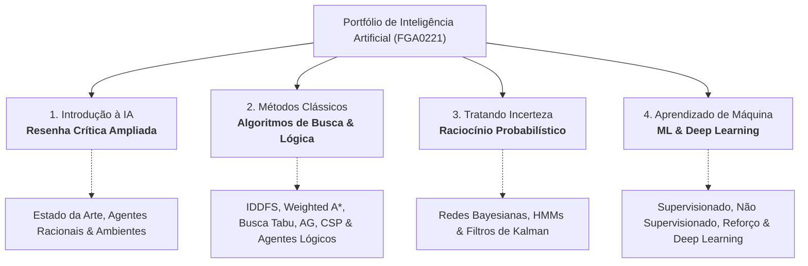

<div align="center">

# Portfólio de Inteligência Artificial
### Engenharia de Sistemas Inteligentes — FGA0221 | UnB – FGA

[](https://www.python.org/)
[](LICENSE)
[](https://fga.unb.br/)
[]()

**Pedro Gomes Oliveira** 
Engenharia de Software — Faculdade de Ciências e Tecnologias em Engenharia (FGA / FCTE)  
**Universidade de Brasília (UnB)**  


</div>

---

## 📌 Apresentação do Portfólio

Este repositório constitui o **Portfólio Individual de Aprendizagem** da disciplina **FGA0221 – Inteligência Artificial** (Turma T01 - 2º/2026) do curso de Engenharia de Software da Universidade de Brasília.

A estrutura do projeto adota a concepção pedagógica de avaliação por portfólio:

> *"O portfólio apresenta várias possibilidades; uma delas é a sua construção pelo aluno. Nesse caso, o portfólio é uma coleção de suas produções, as quais apresentam as evidências de sua aprendizagem. É organizado por ele próprio para que ele e o professor, em conjunto, possam acompanhar o seu progresso."*  
> — **Benigna Maria de Freitas Villas Boas (2008)**

O objetivo é demonstrar competências práticas e teóricas no desenvolvimento de sistemas inteligentes, cobrindo os paradigmas **simbólico, conexionista, evolucionário e probabilístico**, avaliados sob critérios rigorosos de **originalidade, profundidade técnica, clareza, completude e contribuição autoral**.

---

## 🗺️ Mapa de Competências e Estrutura do Curso



---

## 📚 Módulos e Cronograma de Atividades

| Módulo | Atividade no Plano de Ensino | Escopo e Entregáveis | Status |
|:---|:---|:---|:---:|
| **[`Introdução_IA/`](Introdução_IA/)** | **Atividade 1:** Introdução à Inteligência Artificial | Resenha crítica ampliada sobre histórico, agentes inteligentes, ambientes, racionalidade e estado da arte. | `Concluído` ✅ |
| **[`Algoritimos_Classicos/`](Algoritimos_Classicos/)** | **Atividade 2:** Métodos Clássicos de IA | 6 projetos práticos em Python (Busca, Otimização, CSP e Agentes Lógicos) + Relatório Técnico Consolidado. | `Concluído` ✅ |
| **[`Tratando_Incerteza/`](Tratando_Incerteza/)** | **Atividade 3:** Tratando Incerteza | Modelagem probabilística: Redes Bayesianas, Modelos Markovianos Ocultos (HMM) e Filtros de Kalman. | `Em Desenvolvimento` ⏳ |
| **[`Aprendizado_de_Maquina/`](Aprendizado_de_Maquina/)** | **Atividade 4:** Aprendizado de Máquina | Aprendizado Supervisionado, Não Supervisionado, Aprendizado por Reforço e Arquitetura Deep Learning. | `Planejado` ⏳ |

---

## 📖 Módulo 1: Introdução à Inteligência Artificial

* **Foco:** Leitura crítica ampliada, contextualização acadêmica e estado da arte em sistemas inteligentes.
* **Tópicos abordados:**
  - Histórico e evolução da IA desde a era simbólica até a revolução conexionista contemporânea.
  - Tipologias de agentes inteligentes e mapeamento de ambientes de tarefas (PEAS: *Performance, Environment, Actuators, Sensors*).
  - Conceito formal de racionalidade e análise de impacto ético, benefícios e riscos.
* **Documento Consolidado:**
  - 📑 **[Resenha Crítica Ampliada (PDF)](Introdução_IA/Resenha_Critica_IA_PedroGomes.pdf)** — Autoria de Pedro Gomes Oliveira.

---

## ⚙️ Módulo 2: Métodos Clássicos de IA (Algoritmos de Busca e Inferência)

Este módulo abrange a formulação matemática de espaços de busca, funções heurísticas admissíveis e consistentes, operadores genéticos para representações permutacionais restritas e inferência dedutiva simbólica.

Todos os algoritmos foram projetados **sem dependências externas**, utilizando exclusivamente módulos nativos da biblioteca padrão do Python (`heapq`, `random`, `copy`, etc.).

### 🔬 Matriz de Algoritmos Desenvolvidos

| # | Algoritmo Central | Problema da Aula | Problema Alternativo / Aplicado | Arquivo Fonte |
|:---:|:---|:---|:---|:---:|
| **01** | **IDDFS** (*Iterative Deepening Search*) | Rota no Mapa da Romênia (*Arad $\rightarrow$ Bucareste*) | Problema dos Jarros de Água (5L e 3L $\rightarrow$ meta 4L) | [`01_busca_nao_informada.py`](Algoritimos_Classicos/01_busca_nao_informada.py) |
| **02** | **Weighted A*** ($w \ge 1.0$) | Rota na Romênia (*Heurística de Linha Reta - SLD*) | Quebra-Cabeça de 15 Peças (*15-Puzzle* com Distância de Manhattan) | [`02_busca_informada.py`](Algoritimos_Classicos/02_busca_informada.py) |
| **03** | **Busca Tabu** (*Tabu Search* com lista FIFO) | Maximização da Função Côncava $f(x) = -x^2 + 4x + 1$ | Caixeiro Viajante (*TSP* - 5 cidades, vizinhança *Swap 2-opt*) | [`03_busca_complexa.py`](Algoritimos_Classicos/03_busca_complexa.py) |
| **04** | **Algoritmo Genético** (*OX1 + Elitismo*) | Problema das 8 Damas (Cromossomo Permutacional) | Caixeiro Viajante (*TSP* - 8 cidades com representação de ordem) | [`04_algoritimo_genetico.py`](Algoritimos_Classicos/04_algoritimo_genetico.py) |
| **05** | **Min-Conflicts** (*Reparo Local*) | Coloração do Mapa dos Estados da Austrália (3 cores) | Problema das N-Damas em larga escala ($N = 8 \dots 50$) | [`05_CSP.py`](Algoritimos_Classicos/05_CSP.py) |
| **06** | **Forward & Backward Chaining** | Agente Lógico no Mundo do Wumpus (Cláusulas de Horn) | Sistema Especialista para Diagnóstico de Falhas em Redes / TI | [`06_banco_de_conhecimento.py`](Algoritimos_Classicos/06_banco_de_conhecimento.py) |

### 📄 Documentação e Relatórios do Módulo 2
* 📑 **[Relatório Técnico Consolidado (PDF)](Algoritimos_Classicos/relatorio_metodos_classicos_ia_Resenha_Critica_IA_PedroGomes.pdf)** — Relatório técnico com deduções teóricas, gráficos e métricas de desempenho.
* 📝 **[Documento Fonte Editável (DOCX)](Algoritimos_Classicos/relatorio_metodos_classicos_ia_PedroGomes.docx)**.
* 📝 **[Memória Descritiva dos Algoritmos (DOCX)](Algoritimos_Classicos/Algoritimos_entrega2.docx)**.

---

## 🎲 Módulo 3: Tratando Incerteza *(Em Desenvolvimento)*

Dedica-se a sistemas inteligentes operando sob observabilidade parcial e dinamismo estocástico:
1. **Redes Bayesianas:** Modelagem de independência condicional e inferência probabilística exata/aproximada.
2. **Modelos Markovianos Ocultos (HMM):** Filtragem, predição e suavização temporal de estados latentes.
3. **Filtros de Kalman:** Estimação ótima de estados lineares-gaussianos contínuos sob ruído de medição e de processo.

---

## 🤖 Módulo 4: Aprendizado de Máquina *(Planejado)*

Exploração dos paradigmas indutivos da Engenharia de Sistemas Inteligentes:
1. **Aprendizado Supervisionado:** Modelos de regressão e classificação clássicos distintos de redes neurais artificiais.
2. **Aprendizado Não Supervisionado:** Algoritmos de agrupamento (*clustering*) e redução de dimensionalidade.
3. **Aprendizado por Reforço:** Formulação por Processos de Decisão de Markov (MDP) e equações de Bellman (ex.: Q-Learning).
4. **Deep Learning:** Implementação e treinamento de arquitetura neural profunda (CNN, RNN/LSTM ou Transformer) sobre dados públicos de referência.

---

## 🚀 Guia de Execução

Cada algoritmo foi projetado como um script independente e autocontido, sem dependências externas (utilizando exclusivamente a biblioteca padrão do Python).

### 1. Clonar o Repositório
`ash
git clone https://github.com/pedroG0/ai-portfolio.git
cd ai-portfolio
`

### 2. Execução Direta dos Scripts Individuais

Você pode rodar qualquer um dos algoritmos diretamente pelo terminal a partir da raiz do repositório:

`ash
# 01. Busca Não Informada (IDDFS: Jarros de Água e Mapa da Romênia)
python Algoritimos_Classicos/01_busca_nao_informada.py

# 02. Busca Informada (Weighted A*: Mapa da Romênia e 15-Puzzle)
python Algoritimos_Classicos/02_busca_informada.py

# 03. Busca Complexa / Local (Busca Tabu: Maximização de Função e TSP)
python Algoritimos_Classicos/03_busca_complexa.py

# 04. Algoritmo Genético (OX1 e Elitismo: 8 Damas e TSP)
python Algoritimos_Classicos/04_algoritimo_genetico.py

# 05. CSP (Min-Conflicts: Coloração da Austrália e N-Damas N=50)
python Algoritimos_Classicos/05_CSP.py

# 06. Banco de Conhecimento (Forward/Backward Chaining: Wumpus e Diagnóstico TI)
python Algoritimos_Classicos/06_banco_de_conhecimento.py
`

---

## 📂 Arquitetura do Repositório

```bash
IA/
├── Introdução_IA/                                                   # ATIVIDADE 1: INTRODUÇÃO À IA
│   └── Resenha_Critica_IA_PedroGomes.pdf                                    # Resenha crítica ampliada oficial
│
├── Algoritimos_Classicos/                                          # ATIVIDADE 2: MÉTODOS CLÁSSICOS DE IA
│   ├── 01_busca_nao_informada.py                                   # IDDFS (Jarros e Romênia)
│   ├── 02_busca_informada.py                                       # Weighted A* (15-Puzzle e Romênia)
│   ├── 03_busca_complexa.py                                        # Busca Tabu (TSP e f(x))
│   ├── 04_algoritimo_genetico.py                                   # AG com OX1 e Elitismo (8 Damas e TSP)
│   ├── 05_CSP.py                                                   # Min-Conflicts (Austrália e N-Damas)
│   ├── 06_banco_de_conhecimento.py                                 # Forward & Backward Chaining (Wumpus e TI)
│   ├── Algoritimos_entrega2.docx                                   # Memória de cálculo descritiva
│   ├── relatorio_metodos_classicos_ia_Resenha_Critica_IA_PedroGomes.pdf     # Relatório técnico consolidado
│   └── relatorio_metodos_classicos_ia_PedroGomes.docx    # Documento acadêmico editável
│
├── Tratando_Incerteza/                                             # ATIVIDADE 3: TRATANDO INCERTEZA (Em breve)
│   └── .gitkeep
│
├── Aprendizado_de_Maquina/                                         # ATIVIDADE 4: APRENDIZADO DE MÁQUINA (Em breve)
│   └── .gitkeep
│
├── .gitignore                                                      # Regras de exclusão Git
├── LICENSE                                                         # Licença MIT de código aberto
├── README.md                                                       # Documentação técnica central
└── requirements.txt                                                # Especificações de ambiente
```

---

## 📖 Referências Bibliográficas

1. **RUSSELL, S.; NORVIG, P.** *Artificial Intelligence: A Modern Approach*. 4th ed. Pearson, 2022.
2. **FRANKLIN, W.** *Kalman Filter Made Easy*. 1st ed. Franklin, 2022.
3. **HUYEN, C.** *AI Engineering*. 1st ed. O'Reilly, 2025.
4. **BISHOP, C. M.** *Pattern Recognition and Machine Learning*. Springer, 2006.
5. **SUTTON, R. S.; BARTO, A. G.** *Reinforcement Learning: An Introduction*. 2nd ed. MIT Press, 2020.
6. **VILLAS BOAS, B. M. de F.** *O portfólio no dia a dia da sala de aula*. Campinas: Papirus, 2008.

---

## 👨‍💻 Autor

| Perfil | Identificação Acadêmica |
|:---:|:---|
| <br /><sub><b>Pedro Gomes Oliveira</b></sub> | **Estudante:** Pedro Gomes Oliveira<br/>**Instituição:** Universidade de Brasília (UnB)<br/>**Campus:** Faculdade de Ciências e Tecnologias em Engenharia (FGA / FCTE)<br/>**Curso:** Engenharia de Software<br/>**Disciplina:** FGA0221 – Inteligência Artificial (Turma T01)<br/>**Orientador:** Dr. Fabiano Araujo Soares<br/>**GitHub:** [@pedroG0](https://github.com/pedroG0) |

---

## 📜 Licença

Este projeto é protegido sob os termos da licença **MIT**. Para maiores informações, consulte o arquivo [LICENSE](LICENSE).
